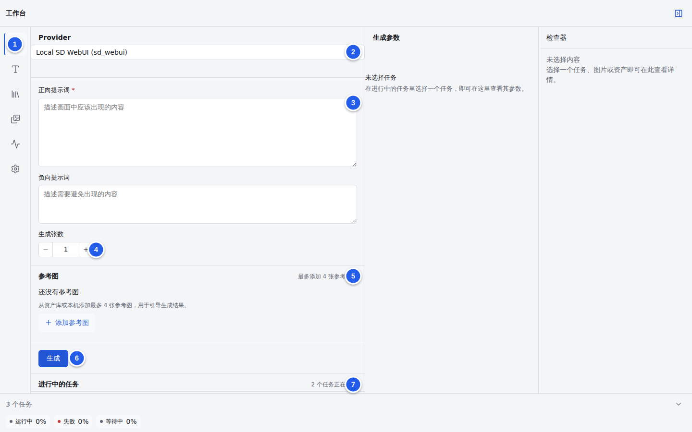
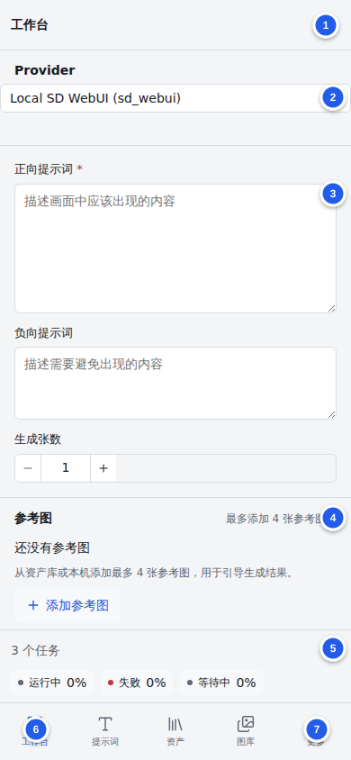
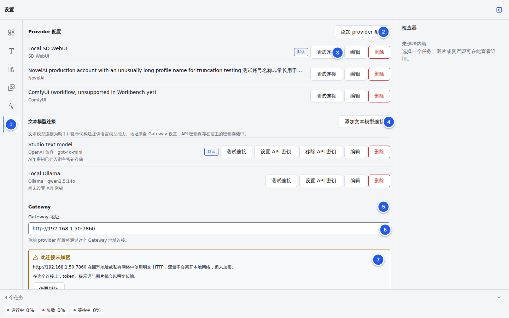
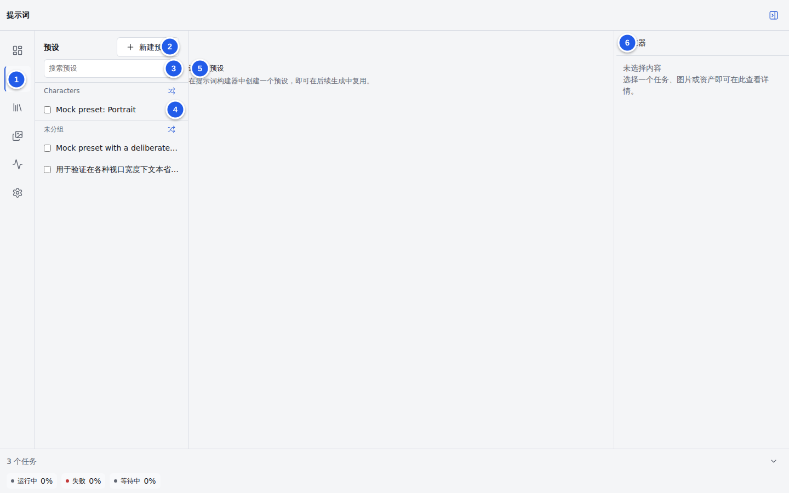
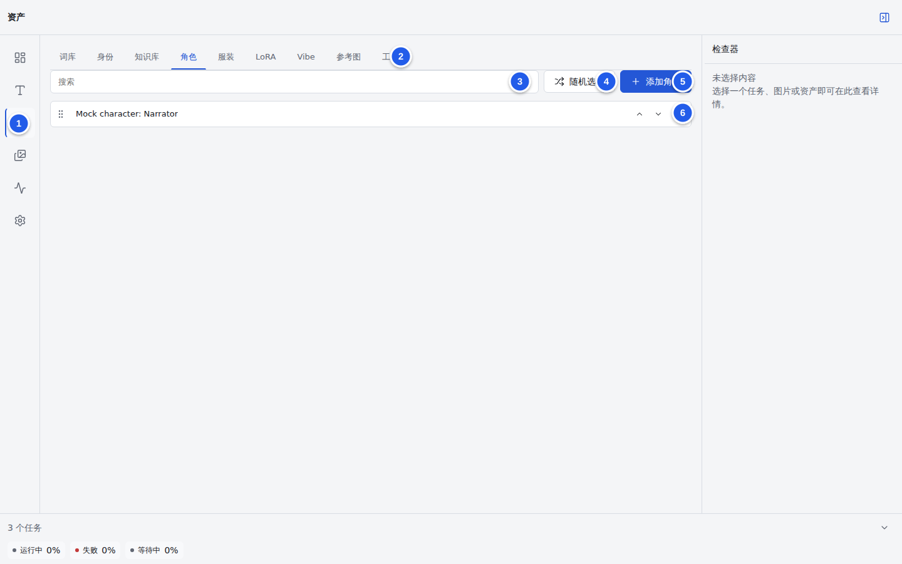
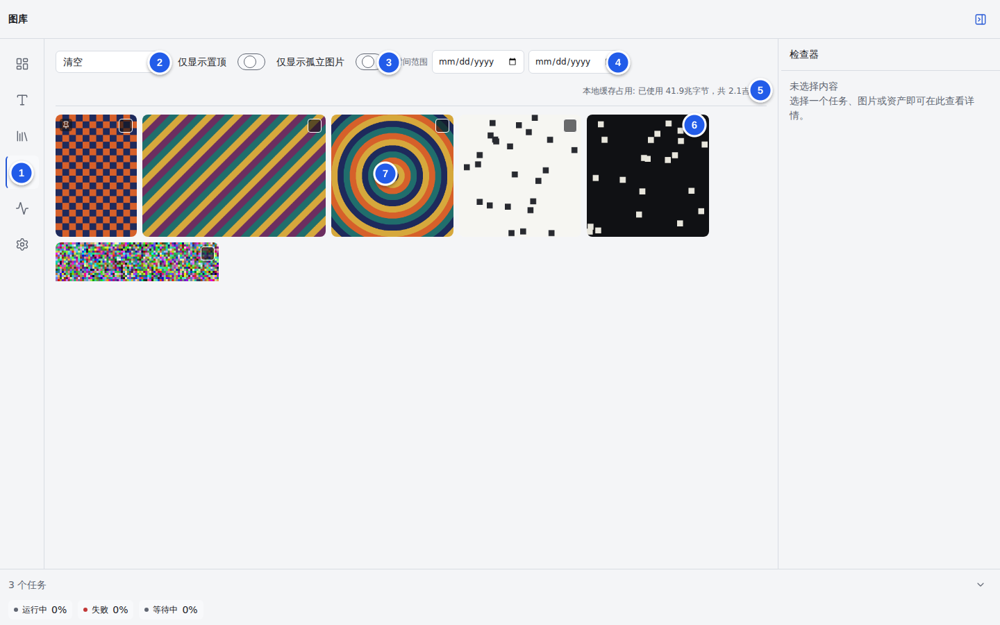
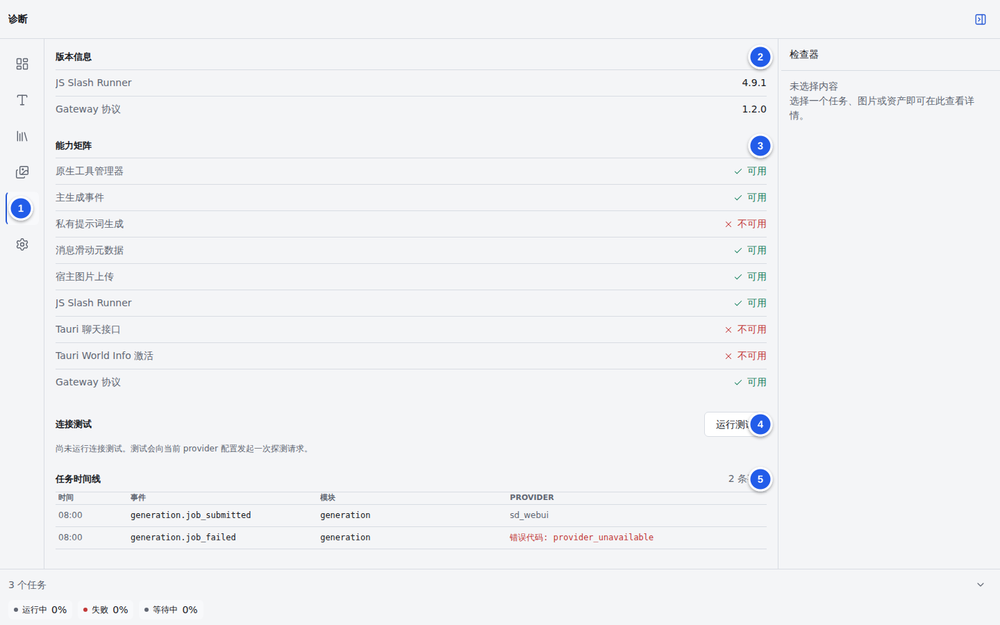

# TavernCanvas（智绘姬）中文使用说明

本文适用于 TavernCanvas 3.0.0，面向在 SillyTavern 中安装和使用扩展的用户。内容以当前源码、运行时契约和项目 E2E 界面为准。截图使用项目自带的确定性演示数据，不包含真实账号、密钥或聊天内容。

> 当前版本仍有若干界面与运行时能力尚未贯通。本文在相应章节明确标出限制，避免把可见按钮误认为已经可用的完整流程。

## 1．快速开始

完成一次手动图片生成需要以下步骤：

1. 安装 SillyTavern 1.18.0 或更高版本，并安装 JS Slash Runner 4.9.1 或更高版本。
2. 通过 SillyTavern 的扩展安装器安装 TavernCanvas。
3. 在“设置”中添加图片 provider 配置，并选择直连云端或 Gateway 传输方式。
4. 回到“工作台”，选择 provider 配置，填写正向提示词，设置生成张数，然后单击“生成”。

建议新用户先关闭“设置 > 自动化 > 每条消息后自动生成”。该选项默认开启，添加可用的默认 provider 配置后，聊天消息可能触发自动生成。确认手动流程正常后再按需开启自动化。

## 2．运行要求

| 项目             | 最低要求                            | 用途                                                       |
| ---------------- | ----------------------------------- | ---------------------------------------------------------- |
| SillyTavern      | 1.18.0                              | 扩展宿主                                                   |
| JS Slash Runner  | 4.9.1                               | 主生成事件、私有提示词、消息滑动元数据和宿主图片上传等能力 |
| TavernCanvas     | 3.0.0                               | 本说明对应版本                                             |
| 浏览器存储       | 可用的 IndexedDB                    | 保存图片、任务、预设和资产                                 |
| Gateway 源码构建 | Node.js 24 或更高版本、pnpm 11.20.0 | 仅在自托管 Gateway 时需要                                  |

TavernCanvas 启动时会探测所需宿主能力。JS Slash Runner 缺失、被禁用或版本过低时，扩展会显示阻止页，并给出最低版本及安装地址，不会进入功能不完整的工作台。

## 3．安装与进入扩展

### 3.1 安装 JS Slash Runner

在 SillyTavern 的第三方扩展安装界面中使用以下仓库地址：

```text
https://github.com/N0VI028/JS-Slash-Runner
```

安装完成后确认扩展已启用。若刚刚升级 JS Slash Runner，重启 SillyTavern 后再检查版本。

### 3.2 安装 TavernCanvas

在同一扩展安装界面中使用以下仓库地址：

```text
https://github.com/ITOTI-Y/tavern-canvas
```

SillyTavern 会从仓库根目录读取 `manifest.json`，并直接加载已提交的 `dist/index.js` 与 `dist/index.css`。正常安装不需要在 SillyTavern 主机上执行源码构建。

安装完成后刷新页面或重启 SillyTavern。扩展默认直接显示全屏工作台，没有斜杠命令或独立工具栏按钮。

### 3.3 切换为简体中文

打开“设置”，滚动到“外观”，将“语言”设为“简体中文”。“跟随 SillyTavern”会根据宿主语言自动选择中文或英文。

“外观”中还可设置浅色、深色或跟随系统主题，检查器宽度可在 240–720 px 范围内调整。

### 3.4 可选入口模式

“设置 > 外观 > 在扩展菜单中显示可选入口”默认关闭。关闭时工作台直接渲染；开启后，界面改由可选入口按钮进入。需要减少工作台对聊天界面的遮挡时可启用该模式。

## 4．界面结构与导航

桌面端使用左侧图标栏，依次进入工作台、提示词、资产、图库、诊断和设置。右侧为检查器，底部为全局任务条。移动端将工作台、提示词、资产和图库放在底部导航中，诊断与设置位于“更多”菜单。



图中编号含义如下：

1. 左侧主导航。
2. 当前图片 provider 配置选择器。
3. 正向和负向提示词编辑区。
4. 生成张数，允许 1–4 张。
5. 参考图区域，最多添加 4 张已保存参考图。
6. “生成”按钮。
7. 进行中的任务列表与底部全局任务条。

右侧检查器根据当前选择显示任务、图片或资产详情。未选择内容时保持空状态。桌面端检查器可折叠，移动端通过右上角按钮打开。



移动端编号含义如下：

1. 检查器入口。
2. provider 配置选择器。
3. 提示词输入区。
4. 参考图区域。
5. 可展开的任务条。
6. 四个主要页面入口。
7. “更多”菜单，其中包含诊断和设置。

## 5．选择 provider 与传输方式

TavernCanvas 将“生成参数”和“网络传输”分开处理。工作台中的 provider 配置决定 provider 类型和模型；传输方式由 Gateway 设置及 provider 类型共同决定。

传输优先级如下：

1. 只要配置了 Gateway 地址，所有图片生成都会发送到 Gateway。
2. 未配置 Gateway 时，NovelAI、OpenAI Image 和 Google Image 使用固定厂商地址直连。
3. 未配置 Gateway 时，SD WebUI 和 ComfyUI 只能直连回环地址，例如 `http://127.0.0.1:7860`。

### 5.1 当前 provider 支持状态

| Provider     | 工作台手动生成 | 浏览器直连               | Gateway 默认运行时 | 凭据位置                            | 当前限制                                                            |
| ------------ | -------------- | ------------------------ | ------------------ | ----------------------------------- | ------------------------------------------------------------------- |
| SD WebUI     | 支持           | 支持，仅允许回环地址     | 支持               | 通常无需云端凭据                    | 新建配置界面没有 `base_url` 输入框，干净安装更适合通过 Gateway 使用 |
| NovelAI      | 支持           | 支持，地址由内置目录固定 | 支持               | SillyTavern 密钥存储或 Gateway 主机 | 直连需要 `allowKeysExposure: true`                                  |
| ComfyUI      | 不支持         | 传输适配器支持回环地址   | 不支持默认运行时   | 由本地服务管理                      | 工作台会明确拒绝该配置；Gateway 启动也会因缺少可执行适配器而失败    |
| OpenAI Image | 支持           | 支持，地址由内置目录固定 | 支持               | SillyTavern 密钥存储或 Gateway 主机 | 直连需要 `allowKeysExposure: true`                                  |
| Google Image | 支持           | 支持，地址由内置目录固定 | 支持               | SillyTavern 密钥存储或 Gateway 主机 | 直连需要 `allowKeysExposure: true`                                  |

当前版本的 provider 配置表单包含名称、Provider、模型、Token 密钥引用和“设为默认”。ComfyUI 还要求填写合法 UUID 格式的工作流 ID。

“Token 密钥引用”只接受宿主密钥存储中的引用名称。明文 API key 应保存在 SillyTavern 的密钥存储中。当前 provider 配置表单没有用于写入云端 provider 明文 key 的独立按钮；无法预先创建密钥引用时，建议使用 Gateway。

### 5.2 添加 provider 配置



图中编号含义如下：

1. 设置入口。
2. “添加 provider 配置”。
3. 单个配置的“测试连接”。
4. 文本模型连接区域。
5. Gateway 区域。
6. Gateway 地址。
7. 明文 HTTP 风险提示。

添加步骤如下：

1. 打开“设置 > Provider 配置”，单击“添加 provider 配置”。
2. 输入便于识别的名称，例如“NovelAI 主账号”。
3. 选择 provider 类型。
4. 输入模型 ID。模型必须与服务端或 Gateway 配置中的允许列表一致。
5. 直连云端时填写已经存在的密钥引用；通过 Gateway 时可留空 provider 密钥引用，因为厂商凭据位于 Gateway 主机。
6. 需要作为新任务默认选择时，开启“设为默认”。
7. 保存后单击“测试连接”。

provider 配置行上的“测试连接”只校验配置结构，并在存在密钥引用时检查该引用是否能在宿主密钥存储中找到。该测试不会向图片 provider 发起网络请求，因此成功结果不能证明厂商服务当前可访问。

### 5.3 当前工作台的固定生成参数

当前工作台没有 provider 专用参数编辑器，除模型外的必填参数由代码固定：

| Provider     | 固定参数                                                                             |
| ------------ | ------------------------------------------------------------------------------------ |
| SD WebUI     | 512 × 512、20 steps、`euler_a`、`normal` scheduler、CFG 7                            |
| NovelAI      | 832 × 1216、28 steps、`k_euler`、scale 5、原生噪声计划、质量开关开启                 |
| OpenAI Image | `size=auto`、`quality=auto`、`background=auto`、PNG 输出；添加参考图后改用 edit 模式 |
| Google Image | 1:1、1K、PNG 输出                                                                    |

OpenAI Image 当前接受以下模型 ID：

```text
gpt-image-1
gpt-image-1-mini
gpt-image-1.5
gpt-image-2
gpt-image-2-2026-04-21
chatgpt-image-latest
```

Google Image 当前接受以下模型 ID：

```text
gemini-2.5-flash-image
gemini-3-pro-image-preview
gemini-3-pro-image
gemini-3.1-flash-image
```

填写其他 OpenAI 或 Google 模型 ID 时，工作台会回退到各自的默认模型 `gpt-image-1` 或 `gemini-2.5-flash-image`。

## 6．配置 Gateway

Gateway 适合需要将厂商凭据留在服务器、通过局域网集中访问 provider，或在干净安装中连接 SD WebUI 的用户。完整部署、环境变量、CORS、HTTPS、备份和恢复方法见 [Gateway 运维文档](gateway.md)。

扩展侧配置步骤如下：

1. 在 Gateway 主机完成 provider 配置和 bearer token 配置，并确认 `/healthz` 可访问。
2. 在 TavernCanvas 中添加对应 provider 类型与模型的配置。模型需包含在 Gateway 该 provider 的 `model_allowlist` 中。
3. 打开“设置 > Gateway”，输入 `http://` 或 `https://` 的 Gateway origin，例如 `http://127.0.0.1:8787`。输入框失焦时保存。
4. 使用 `http://` 时阅读风险提示，并单击“仍要继续”。确认按规范化 origin 分别记录；更换地址后需要重新确认。
5. 在“Gateway 访问 token”中输入明文 bearer token，然后单击“保存 token”。明文会直接写入 SillyTavern 密钥存储，设置中只保留引用。
6. 单击“检测协议”。该操作探测 Gateway；诊断页的连接测试使用同一 Gateway 探测能力。
7. 回到工作台选择 provider 配置并执行一次手动生成。

配置 Gateway 后，Gateway 的优先级高于所有直连方式。清空 Gateway 地址可恢复直连选择逻辑。

SillyTavern 从密钥存储取回 Gateway token 时仍需在 `config.yaml` 中设置：

```yaml
allowKeysExposure: true
```

修改后重启 SillyTavern。该开关允许同一 SillyTavern 页面中的脚本读取已保存密钥明文。Gateway 模式下浏览器只需读取 Gateway bearer token，厂商 API key 始终留在 Gateway 主机。

回环地址上的明文 HTTP 流量不会离开本机，但仍未加密。局域网或公网部署应使用 HTTPS 反向代理；明文 HTTP 会暴露 token、提示词和图片内容。

## 7．在工作台生成图片

### 7.1 参考图记录的当前限制

“资产 > 参考图”的新建表单当前只保存名称、来源链接和备注，没有上传或持久化图片字节的能力。工作台仍允许从这些记录中选择最多 4 条并附加其资产 ID，但需要真实图片输入的 provider 无法仅凭这类元数据完成参考图生成。

当前版本不要依赖该入口完成 NovelAI Vibe、OpenAI edit 或 Google 参考图生成。没有其他已持久化图片来源时，请保持工作台参考图列表为空。界面文案中的“添加参考图”只表示选择资产记录，不能替代图片上传。

### 7.2 提交手动任务

1. 在“Provider”下拉框中选择配置。
2. 在“正向提示词”中描述需要出现的内容。该字段必填。
3. 在“负向提示词”中描述需要避免的内容。该字段可留空。
4. 将“生成张数”设为 1–4。
5. 按需添加参考图。
6. 单击“生成”。

提交按钮会检查以下条件：已经选择 provider 配置、正向提示词非空、生成张数在 1–4 范围内，并且 provider 可由工作台构建请求。ComfyUI 配置会在此处被拒绝。

### 7.3 查看、取消和重试任务

新任务出现在“进行中的任务”和底部任务条中。状态包括排队中、准备中、提交中、运行中、已完成、失败、已取消、已关联和孤立。

选择任务后，中间的“生成参数”区域会显示 seed、steps、sampler、模型、provider 和提交时间；右侧检查器显示所选内容详情。已完成任务还会显示结果预览。

取消任务需要二次确认。Gateway 任务取消时，扩展会同步发送远端取消请求。失败任务可根据界面提供的“重新生成”入口重试；排查具体错误时转到诊断页查看任务时间线。

### 7.4 自动生成与回退

“设置 > 自动化”提供以下选项：

| 设置                                 | 当前行为                                               |
| ------------------------------------ | ------------------------------------------------------ |
| 每条消息后自动生成                   | 默认开启；存在有效默认 provider 后，聊天消息可触发生成 |
| 失败时自动切换到下一个 provider 配置 | 默认开启                                               |
| 全局并发请求数                       | 默认 4，可设为 1–4                                     |
| 单个 provider 并发请求数             | 当前固定为 1，界面控件处于禁用状态                     |

只需手动生成时，关闭“每条消息后自动生成”。启用回退前应确保备用配置的模型、凭据和传输方式均可用，否则错误只会转移到下一配置。

## 8．提示词预设



图中编号含义如下：

1. 提示词页面入口。
2. 新建预设。
3. 预设搜索。
4. 分组和预设列表。
5. 预设编辑区；选择或新建预设后显示表单。
6. 全局检查器。

创建和编辑预设的流程如下：

1. 单击“新建预设”，或在左侧选择已有预设。
2. 编辑名称、固定正向提示词和固定负向提示词。
3. 按需添加替换规则。规则会在请求发送给 provider 前转换匹配文本。
4. 按需添加正则规则。可在规则旁输入测试文本并运行测试；无效表达式会直接显示错误。
5. 单击“保存”，等待成功提示。

切换预设或新建预设前若存在未保存修改，界面会要求确认是否放弃修改。批量勾选预设后可以永久删除所选项。

“质量控制”中的 UCP 与 AQT 开关当前只保留在本次页面状态中，没有写入预设草稿。重新选择预设或刷新页面后不要依赖其状态继续存在。

“私有提示词测试”在当前生产能力中尚未接通。没有私有 LLM 通道时，界面会明确显示不可用，且不会静默发送请求。

## 9．资产库



图中编号含义如下：

1. 资产页面入口。
2. 资产分类标签。
3. 当前分类搜索。
4. 随机选择。
5. 新增当前分类记录。
6. 可排序、编辑和删除的记录列表。

资产分类及用途如下：

| 分类   | 保存内容                                      | 主要用途                                           |
| ------ | --------------------------------------------- | -------------------------------------------------- |
| 词库   | 可搜索标签包                                  | 搜索并插入提示词标签                               |
| 身份   | 说话人、描述、开场白、角色类型                | 为用户或助手提供人设上下文                         |
| 知识库 | 标题、来源、正文、关键词、优先级              | 关键词命中时注入提示词                             |
| 角色   | 名称、角色定位、外观、上下文、World Info 引用 | 在多次生成中复用角色描述                           |
| 服装   | 角色关联与服装描述                            | 复用角色服装                                       |
| LoRA   | 名称、权重和触发词                            | 记录 LoRA 元数据                                   |
| Vibe   | NovelAI 或 Google 分组、强度、信息提取度      | 复用参考图分组                                     |
| 参考图 | 名称、来源链接和备注，不保存图片字节          | 记录参考来源；当前不能独立提供工作台所需的图片输入 |
| 工作流 | ComfyUI JSON 与占位符映射                     | 管理工作流元数据                                   |

记录支持搜索、随机选择、上移、下移、拖拽排序和删除。删除会永久移除资产，确认前应检查它是否仍被预设或生成流程引用。

### 9.1 词库

“词库”支持检查更新和导入词库包。可在“设置 > 数据”选择内置基线包或远程更新渠道，也可导入 `.jsonl`、`.ndjson` 或旧版 v2 `.json` 文件。大型导入会显示读取、解析、索引、分片写入和启用进度，并允许取消。

可能包含成人内容的词库包默认不显示，需要手动开启披露选项。详细包格式和更新机制见 [词库包说明](vocabulary-packages.md)。

### 9.2 ComfyUI 工作流

打开“资产 > 工作流”，单击“导入工作流”，选择 JSON 文件，然后使用“扫描占位符”。当前可映射的目标包括正向提示词、负向提示词、Seed、宽度、高度和 Steps。

工作流资产可以保存和编辑，但当前工作台不支持从 ComfyUI 配置提交手动生成，Gateway 默认运行时也没有 ComfyUI 可执行适配器。导入成功不代表当前工作台已经可以运行该工作流。

## 10．图库管理



图中编号含义如下：

1. 图库入口。
2. provider 筛选。
3. 仅显示置顶或孤立图片。
4. 日期范围。
5. 浏览器本地存储占用。
6. 单图选择开关。
7. 图片网格；单击图片打开预览。

### 10.1 筛选与预览

可按 provider、置顶状态、孤立状态和日期范围筛选。单击缩略图打开大图预览，使用上一张和下一张浏览当前筛选结果。预览中可以置顶、下载、删除或解除消息关联。

“解除关联”只移除图片与消息之间的关系，图片仍保留在图库中；“删除”会永久删除图片记录及文件。批量操作提供下载所选、删除所选和解除关联，删除前会再次确认。

### 10.2 参数复制与重新生成

SD WebUI 或 NovelAI 图片若包含可识别的嵌入参数，详情面板会显示 seed、模型和提示词，并允许复制原始参数。“修改提示词”和“重新生成”会把已解析的正向、负向提示词带回工作台。

OpenAI Image、Google Image 或缺少可识别文本块的图片可能显示“没有找到嵌入的生成参数”。这是受支持的空状态；仍可跳转工作台，但不会自动填入缺失参数。

### 10.3 当前媒体操作限制

图库中可见“编辑图片”和“局部重绘”入口。当前实现只记录操作意图并跳转到工作台，工作台没有继续打开编辑器或提交媒体命令。因此，跳转成功不表示编辑或局部重绘已经执行。

“跳转到来源消息”当前处于禁用状态，因为宿主没有提供聊天导航能力。

## 11．诊断与支持包



图中编号含义如下：

1. 诊断入口。
2. JS Slash Runner 与 Gateway 协议版本信息。
3. 宿主能力矩阵。
4. Gateway 连接测试。
5. 任务时间线。

诊断页包含以下信息：

- **版本信息**：显示 JS Slash Runner 和 Gateway 协议版本。
- **能力矩阵**：显示主生成事件、私有提示词、消息滑动元数据、宿主图片上传、Tauri 增强和 Gateway 协议是否可用。
- **连接测试**：只在配置 Gateway 时探测 Gateway；未配置时返回 `gateway_not_configured`。
- **任务时间线**：记录生成状态、模块、provider 和错误代码，不记录提示词或消息正文。内存中最多保留 500 条。
- **迁移状态**：显示 v2 迁移阶段、记录数量和警告。
- **存储**：显示浏览器估算占用与配额；接近配额时提示清理。
- **支持包**：本地生成并下载版本、能力矩阵、脱敏设置、错误代码和任务时间线。

支持包不包含提示词、消息内容、密钥或图片文件名。发送给维护者前仍建议自行检查文件内容。

## 12．v2 迁移、归档与恢复

### 12.1 v2 数据迁移

迁移可导入 v2 `st-chatu8` 的设置、图库记录、配置图片和同源宿主图片。流程会记录日志，可恢复并可重复执行。数据复制完成后会先检查记录数量、图片内容和哈希；验证成功后才切换活动命名空间。迁移失败不会覆盖 v2 源数据。

在“设置 > 数据”或“诊断 > 迁移状态”查看结果。失败时使用“查看迁移报告”确认原因，然后单击“重试迁移”。常见原因包括源数据无效、图片缺失、哈希不一致、记录数不一致和密钥迁移受阻。

界面中存在“清理旧版 v2 数据”操作，但当前运行时明确拒绝实际清理。迁移完成后仍需手动移除 v2 扩展及其旧数据。执行手动删除前保留归档，并确认 TavernCanvas 已能正常读取迁移后的数据。

### 12.2 导出归档

打开“设置 > 数据”，单击“导出归档”。导出内容包括当前活动命名空间的业务记录、JSONL 数据、内容寻址图片、`manifest.json` 和 `checksums.json`，并使用 ZIP 容器保存。

当前界面将下载文件命名为：

```text
tavern-canvas-archive.json
```

文件内容实际为 ZIP。保留原文件即可由“导入归档”读取；不要把它当作普通 JSON 文本编辑。

归档不包含明文凭据、Gateway token、日志或支持包。语言、并发和 Gateway 地址等保存在 SillyTavern `extension_settings` 中的小型设置也不属于业务记录归档，恢复环境时应另行记录这些设置。

### 12.3 导入归档

单击“导入归档”并选择先前导出的文件。导入会验证归档结构、校验和与图片内容，然后把记录合并到当前命名空间，不会删除已有数据。为减少重名或重复记录带来的混淆，建议在导入前额外备份当前环境。

扩展归档只覆盖浏览器中的活动命名空间，不覆盖 Gateway 的 SQLite、图片目录或环境变量。Gateway 备份方法见 [Gateway 运维文档的 Backup 章节](gateway.md#backup)。

## 13．数据、隐私与安全

TavernCanvas 的主要本地数据保存在浏览器 IndexedDB 数据库 `tavern_canvas_v3` 中，包括生成图片、提示词预设、角色配置、知识条目、词库包和任务记录。图片按 SHA-256 内容寻址保存。扩展设置保存在 SillyTavern 的 `tavern_canvas` 设置项中。

使用时应注意以下边界：

- 扩展设置只保存密钥引用，不保存 provider 或 Gateway 明文凭据。
- 直接云端调用需要 `allowKeysExposure: true`，这会扩大同页脚本读取宿主密钥的权限。
- SD WebUI 和 ComfyUI 的直连地址必须是回环地址，非回环地址会被拒绝。
- Gateway 的 `http://` 地址必须按 origin 单独确认。确认只记录风险接受状态，不会加密流量。
- 除回环地址外，Gateway 应放在 HTTPS 反向代理后。
- 项目没有遥测或分析。网络请求只会发送到已配置 provider、Gateway 或用户主动打开的词库目录。
- 清除浏览器站点数据会删除 IndexedDB 中的图片和资产。执行前先导出归档。

## 14．常见故障排查

| 现象                                        | 原因                                                | 处理方法                                                                              |
| ------------------------------------------- | --------------------------------------------------- | ------------------------------------------------------------------------------------- |
| 启动后只显示阻止页                          | JS Slash Runner 缺失、禁用或版本低于 4.9.1          | 安装或升级 JS Slash Runner，启用后重启 SillyTavern                                    |
| “生成”按钮不可用或提交后提示缺少配置        | 未选择 provider 配置                                | 在设置中添加配置，并在工作台下拉框中选中                                              |
| 提示正向提示词必填                          | 正向提示词为空                                      | 填写画面主体、场景和风格描述                                                          |
| ComfyUI 配置无法从工作台生成                | 当前工作台不构建 ComfyUI 请求                       | 改用受支持 provider；等待工作台接入真实工作流选择能力                                 |
| 直连云端提示 SillyTavern 拒绝显示密钥       | `allowKeysExposure` 未开启                          | 在 `config.yaml` 设置 `allowKeysExposure: true` 并重启，或改用 Gateway                |
| 直连本地 provider 报回环地址错误            | `base_url` 使用了局域网、公网或非法地址             | 使用 `127.0.0.1`、`localhost` 或 `[::1]`；远程访问通过 Gateway                        |
| 新建 SD WebUI 配置后无法直连                | 当前配置表单没有 `base_url` 输入框                  | 在干净安装中优先通过 Gateway 使用 SD WebUI                                            |
| Gateway 已配置但任务提示没有 token          | 只填了地址，尚未保存访问 token                      | 在“Gateway 访问 token”输入明文 token 并单击“保存 token”                               |
| Gateway 提示明文来源未确认                  | 使用了未确认的 `http://` origin                     | 阅读风险提示并单击“仍要继续”，或改用 HTTPS                                            |
| “检测协议”失败                              | Gateway 不可达、CORS 不匹配、token 错误或协议不兼容 | 检查 `/healthz`、精确 CORS origin、token 和诊断错误码                                 |
| provider 配置“测试连接”成功，但实际生成失败 | 该测试只校验结构和密钥引用，没有访问 provider       | 在诊断时间线查看 `auth_failed`、`provider_unavailable`、`rate_limited` 或 `timed_out` |
| 添加参考图后生成失败或没有参考效果          | 新建参考图记录只保存链接和备注，没有图片字节        | 清空工作台参考图列表；当前版本不要依赖该入口执行参考图生成                            |
| 图库没有嵌入参数                            | 图片格式或 provider 没有可识别参数块                | 可手动填写工作台提示词；OpenAI 和 Google 图片出现该状态属正常情况                     |
| “跳转到来源消息”不可用                      | 当前宿主没有聊天导航能力                            | 在 SillyTavern 中手动定位原消息                                                       |
| “编辑图片”或“局部重绘”只回到工作台          | 媒体操作尚未贯通                                    | 当前版本不能从该入口完成编辑或重绘                                                    |
| 浏览器存储接近配额                          | 图片和资产占用较高                                  | 先导出归档，再在图库删除不需要的图片                                                  |
| v2 迁移失败                                 | 源记录、图片或校验不一致                            | 保留 v2 数据，查看迁移报告，修复源问题后重试                                          |
| “清理旧版 v2 数据”报错                      | 当前运行时没有实现 v2 清理                          | 确认迁移和归档后手动移除 v2 扩展及旧数据                                              |

## 15．快捷参考

| 操作                                 | 位置                          |
| ------------------------------------ | ----------------------------- |
| 添加或测试图片 provider              | 设置 > Provider 配置          |
| 配置文本模型连接                     | 设置 > 文本模型连接           |
| 配置 Gateway                         | 设置 > Gateway                |
| 关闭自动生成                         | 设置 > 自动化                 |
| 切换中文或主题                       | 设置 > 外观                   |
| 导入词库、导出或导入归档             | 设置 > 数据                   |
| 手动生成图片                         | 工作台                        |
| 创建固定提示词、替换规则和正则规则   | 提示词                        |
| 管理角色、服装、参考图和工作流       | 资产                          |
| 筛选、下载、置顶、解除关联或删除图片 | 图库                          |
| 查看错误码、迁移和存储               | 诊断                          |
| 部署和维护 Gateway                   | [docs/gateway.md](gateway.md) |

项目安装、构建和发布命令可查阅[项目 README](../README.md)。本说明聚焦最终用户操作，不重复开发者构建流程。
